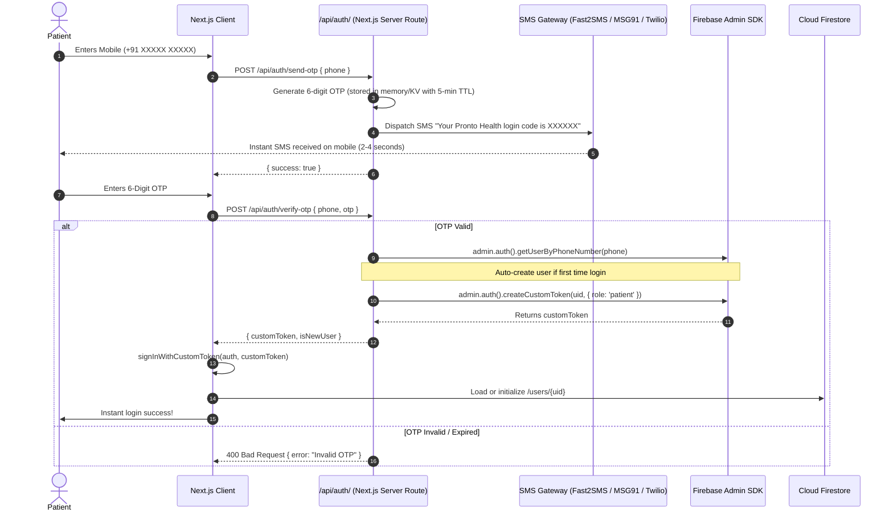
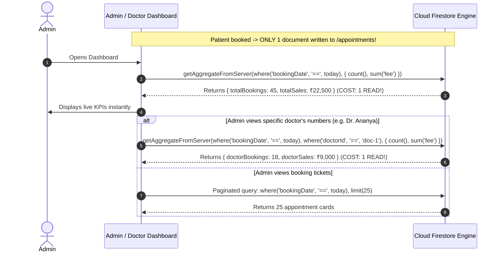

# Pronto Health — Scalable Backend Architecture & Implementation Plan

> **Target Scale**: 1,000 – 2,000+ Daily Active Users (DAU)  
> **Core Stack**: Next.js App Router + Firebase (Firestore, Auth, Admin SDK) + Cloudinary Media Engine + DLT SMS Gateway  
> **Last Updated**: October 2026

---

## 1. System Architecture Overview

```mermaid
graph TD
    subgraph Clients["Frontend Clients (Next.js App Router)"]
        P["Patient Web App"]
        D["Doctor Portal (Future)"]
        A["Admin Ops Desk (Doctor Management)"]
    end

    subgraph AuthLayer["Zero-Captcha Authentication Engine"]
        OTP_EP["/api/auth/send-otp & /api/auth/verify-otp"]
        SMS_GW["SMS Gateway (Fast2SMS / MSG91 / Twilio)"]
        FB_ADMIN["Firebase Admin SDK (Custom Tokens)"]
        FB_AUTH["Firebase Auth (signInWithCustomToken)"]
    end

    subgraph StorageLayer["Data & Media Engine"]
        FS[("Cloud Firestore (Database)")]
        CL[("Cloudinary Media Engine")]
    end

    P -->|Enter Phone Number| OTP_EP
    OTP_EP --> SMS_GW
    SMS_GW -->|Direct SMS OTP| P
    P -->|Verify OTP| OTP_EP
    OTP_EP --> FB_ADMIN
    FB_ADMIN -->|Custom Token| P
    P -->|Sign In| FB_AUTH

    P -->|Upload 4-5MB Camera Slip| CL
    CL -->|Auto Compress to ~150KB WebP/PDF| CL
    CL -->>|Returns secure compressed URL| P
    P -->|Save Prescriptions & Bookings| FS

    A -->|Add / Edit / Toggle Active Doctors| FS
    P -->|Read Active Doctors Directory| FS
    D -->|View Assigned Consultations| FS
```

---

## 2. Zero-Captcha Mobile OTP Authentication

Patients sign in using their 10-digit Indian mobile number with direct SMS delivery — **zero visual captchas, puzzles, or checkboxes**.

### Authentication Flow



### Whitelisted Test Numbers for Development
To prevent burning SMS credits during development:
- Phone: `+91 98765 43210` $\rightarrow$ Fixed OTP: `123456`
- Phone: `+91 99999 99999` $\rightarrow$ Fixed OTP: `123456`

---

## 3. Cloudinary Prescription Pipeline (4–5 MB $\rightarrow$ < 200 KB)

High-resolution smartphone cameras produce 4–5 MB JPEG/HEIC files. Cloudinary converts and compresses them on the fly:

```
[Phone Camera Photo (4–5 MB)]
               │
               ▼
   [Cloudinary Direct Upload]
   Preset: 'pronto_prescriptions'
               │
               ▼
[Dynamic Transformation Pipeline]
   • format: 'auto' (serves WebP on web, convertible to PDF)
   • quality: 'auto:good' (perceptual compression preserving text clarity)
   • effect: 'auto_contrast' (sharpens doctor handwriting & cleans shadows)
   • max_width: 1600px (retina-sharp, zero pixelation)
               │
               ▼
   [Result: 120 KB – 180 KB File]
   [96% Bandwidth & Storage Reduction]
               │
               ▼
[Save secure_url & public_id to Firestore prescriptions]
```

### Frontend Upload Helper
```typescript
export async function uploadSlipToCloudinary(file: File, patientUid: string) {
  const formData = new FormData();
  formData.append("file", file);
  formData.append("upload_preset", process.env.NEXT_PUBLIC_CLOUDINARY_PRESET!);
  formData.append("folder", `prescriptions/${patientUid}`);
  formData.append("transformation", "q_auto:good,f_auto,w_1600,c_limit,e_auto_contrast");

  const res = await fetch(
    `https://api.cloudinary.com/v1_1/${process.env.NEXT_PUBLIC_CLOUDINARY_CLOUD_NAME}/image/upload`,
    { method: "POST", body: formData }
  );

  const data = await res.json();
  return {
    url: data.secure_url,
    pdfUrl: data.secure_url.replace(/\.[^/.]+$/, ".pdf"),
    publicId: data.public_id,
    bytes: data.bytes, // ~150 KB
  };
}
```

---

## 4. Scalable Firestore Schema

### 1. `/users/{uid}` (Patient Profile with Optional Address)
```typescript
interface UserProfile {
  uid: string;
  phone: string;                      // "+919876543210"
  role: 'patient' | 'doctor' | 'admin';
  name: string;
  healthId: string;                   // "#PRN-8821-LKO"
  
  // Optional Patient Address Details
  address?: {
    houseNo?: string;                 // Flat / House / Plot #
    street?: string;                  // Street / Road / Area
    locality?: string;                // "Viram Khand 5, Gomti Nagar"
    city?: string;                    // "Lucknow"
    state?: string;                   // "Uttar Pradesh"
    pincode?: string;                 // "226010"
  };

  isVerified: boolean;
  createdAt: FirebaseFirestore.Timestamp;
  updatedAt: FirebaseFirestore.Timestamp;
}
```

### 2. `/doctors/{doctorId}` (Admin-Managed Only)
> Doctors shown on the home page come strictly from this collection. They are added and toggled exclusively by Admin.

```typescript
interface DoctorDocument {
  id: string;                         // "doc-ananya-sharma"
  name: string;                       // "Dr. Ananya Sharma"
  specialty: string;                  // "Cardiology & Internal Medicine"
  specialtyCategory: string;          // "Cardiology" (for category filtering)
  clinic: string;                     // "Apollo Clinic, Gomti Nagar"
  rating: number;                     // 4.9
  reviews: number;                    // 1420
  experienceYears: number;            // 12
  consultationFee: number;            // 500
  regularFee: number;                 // 800
  image: string;                      // Cloudinary CDN URL
  isNew?: boolean;
  isActive: boolean;                  // Managed by Admin: true = shown on Home page
  addedByAdminUid: string;            // Admin UID
  createdAt: FirebaseFirestore.Timestamp;
  updatedAt: FirebaseFirestore.Timestamp;
}
```

### 3. `/appointments/{appointmentId}` (Single-Read Self-Contained Snapshot)
> **Zero N+1 Guarantee**: Every appointment contains all display fields (Doctor details, Clinic, Patient name, Fees) directly in the document. Fetching 1 appointment ticket = **exactly 1 read**, with ZERO secondary doctor or clinic lookups!

```typescript
interface AppointmentDocument {
  id: string;                         // "apt-1730000000"
  patientUid: string;
  patientName: string;
  patientPhone: string;
  patientHealthId: string;
  patientAddress?: string;            // Denormalized for doctor/desk reference
  doctorId: string;                   // Reference to /doctors/{doctorId}
  doctorName: string;
  doctorSpecialty: string;
  clinicName: string;
  followupDate: string;               // "2026-11-02"
  timeWindow: string;                 // "Evening (5:00 PM - 7:00 PM)"
  status: 'Pending Screening' | 'Escalated to Physical Visit' | 'Screening Complete' | 'Cancelled';
  consultationFee: number;
  prescriptionUrl?: string;           // Cloudinary URL
  queueBypassCode: string;            // "PRN-FAST-8821"
  patientNotes?: string;
  doctorClinicalNotes?: string;      // Written by doctor during consultation
  createdAt: FirebaseFirestore.Timestamp;
  updatedAt: FirebaseFirestore.Timestamp;
}
```

### 4. `/prescriptions/{prescriptionId}` (Single-Read Self-Contained Record)
```typescript
interface PrescriptionDocument {
  id: string;                         // "presc-1730000000"
  patientUid: string;
  doctorName: string;
  clinicName: string;
  visitDate: string;                  // "2026-10-18"
  imageUrl: string;                   // Cloudinary optimized WebP URL
  pdfUrl?: string;                    // 1-Click PDF URL
  cloudinaryPublicId: string;
  fileSizeBytes: number;              // ~150 KB
  chiefComplaint?: string;
  uploadedAt: FirebaseFirestore.Timestamp;
}
```

### 5. Smart Single-Write Architecture & Server-Side Aggregations (`count` & `sum`)

> **Why This Is Smarter**:
> 1. **Exactly 1 Write per Booking**: Every booking writes **ONLY 1 document** (`/appointments/{aptId}`). Zero document lock contention, zero counter hotspots during peak hours, and < 15ms write speed!
> 2. **Server-Side Aggregation (`count()` & `sum()`)**: Google Firestore's server engine aggregates matches directly on the cloud index.
> 3. **Google Billing Rule**: Google charges **1 read for every 1,000 index items matched**. A query scanning 1,000 bookings costs **EXACTLY 1 READ** ($0.00000038)! Even scanning 1 Lakh bookings costs only 100 reads!

---

#### A. How Admin & Doctor Fetch Sales & Booking Numbers (1 Read Each)



---

#### B. Implementation Code Patterns

##### 1. Clean 1-Write Booking Function:
```typescript
import { collection, addDoc, serverTimestamp } from "firebase/firestore";

export async function bookAppointment(db: Firestore, bookingData: AppointmentInput): Promise<string> {
  const today = new Date().toISOString().split("T")[0]; // "YYYY-MM-DD"
  
  // Exactly 1 write: self-contained snapshot with fee & bookingDate
  const docRef = await addDoc(collection(db, "appointments"), {
    ...bookingData,
    bookingDate: today,
    createdAt: serverTimestamp(),
  });

  return docRef.id;
}
```

##### 2. Admin: Get Today's Overall Bookings & Total Sales (1 Read):
```typescript
import { query, collection, where, getAggregateFromServer, count, sum } from "firebase/firestore";

export async function getTodayOverallSales(db: Firestore, todayDate: string) {
  const q = query(
    collection(db, "appointments"),
    where("bookingDate", "==", todayDate)
  );

  const snapshot = await getAggregateFromServer(q, {
    totalPatients: count(),
    totalRevenue: sum("consultationFee"),
  });

  return {
    totalPatients: snapshot.data().totalPatients, // e.g. 45
    totalRevenue: snapshot.data().totalRevenue,   // e.g. 22500
  };
}
```

##### 3. Doctor & Admin: Get Specific Doctor's Patients & Sales Today (1 Read):
```typescript
export async function getDoctorDailySales(db: Firestore, doctorId: string, todayDate: string) {
  const q = query(
    collection(db, "appointments"),
    where("bookingDate", "==", todayDate),
    where("doctorId", "==", doctorId)
  );

  const snapshot = await getAggregateFromServer(q, {
    doctorPatients: count(),
    doctorRevenue: sum("consultationFee"),
  });

  return {
    doctorPatients: snapshot.data().doctorPatients, // e.g. 18
    doctorRevenue: snapshot.data().doctorRevenue,   // e.g. 9000
  };
}
```

##### 4. Admin: View Booking Tickets (Paginated & Filtered):
```typescript
// Query for all bookings today (paginated)
const qAll = query(
  collection(db, "appointments"),
  where("bookingDate", "==", todayDate),
  orderBy("createdAt", "desc"),
  limit(25)
);

// Query filtered by doctor (executed on server composite index)
const qByDoc = query(
  collection(db, "appointments"),
  where("bookingDate", "==", todayDate),
  where("doctorId", "==", selectedDoctorId),
  orderBy("createdAt", "desc"),
  limit(25)
);
```

---

#### C. Optional Future Scale: Cloud Function Rollup (for 50+ Doctors in 1 Read)
When your clinic network grows past 50 doctors and Admin wants a table of all 50 doctors' numbers in a single document:
- A Google Cloud Function `onDocumentCreated("appointments/{id}")` runs in the background (Google gives **2 Million free invocations/month**).
- It rolls up daily doctor counts into `/analytics_daily/{today}`.
- Booking on the client remains **strictly 1 write**!

---

## 5. Firestore Security Rules

```javascript
rules_version = '2';
service cloud.firestore {
  match /databases/{database}/documents {
    
    function isAuthenticated() {
      return request.auth != null;
    }
    function isOwner(uid) {
      return isAuthenticated() && request.auth.uid == uid;
    }
    function isAdmin() {
      return isAuthenticated() && (
        request.auth.token.role == 'admin' ||
        get(/databases/$(database)/documents/users/$(request.auth.uid)).data.role == 'admin'
      );
    }
    function isDoctor() {
      return isAuthenticated() && request.auth.token.role == 'doctor';
    }

    // 1. Doctors: Publicly readable for active doctors, WRITABLE ONLY BY ADMIN
    match /doctors/{doctorId} {
      allow read: if resource.data.isActive == true || isAdmin();
      allow create, update, delete: if isAdmin();
    }

    // 2. Users (Patient Profiles & Addresses)
    match /users/{uid} {
      allow read: if isOwner(uid) || isAdmin();
      allow create: if isOwner(uid);
      allow update: if isOwner(uid) && request.resource.data.role == resource.data.role || isAdmin();
      allow delete: if isAdmin();
    }

    // 3. Appointments
    match /appointments/{appointmentId} {
      allow read: if isAuthenticated() && (
        resource.data.patientUid == request.auth.uid ||
        resource.data.doctorId == request.auth.token.doctorId ||
        isAdmin()
      );
      allow create: if isAuthenticated() && request.resource.data.patientUid == request.auth.uid;
      allow update: if isAuthenticated() && (
        resource.data.patientUid == request.auth.uid ||
        resource.data.doctorId == request.auth.token.doctorId ||
        isAdmin()
      );
    }

    // 4. Prescriptions
    match /prescriptions/{prescriptionId} {
      allow read: if isAuthenticated() && (
        resource.data.patientUid == request.auth.uid ||
        isAdmin()
      );
      allow create: if isAuthenticated() && request.resource.data.patientUid == request.auth.uid;
      allow update, delete: if isOwner(resource.data.patientUid) || isAdmin();
    }
  }
}
```

---

## 6. Composite Indexes (Fast Scale)

| Collection | Fields | Query Purpose |
| :--- | :--- | :--- |
| `appointments` | `patientUid` ASC + `createdAt` DESC | Patient's recent bookings list |
| `appointments` | `bookingDate` ASC + `createdAt` DESC | **Admin: All bookings made today** |
| `appointments` | `bookingDate` ASC + `doctorId` ASC + `createdAt` DESC | **Admin: Today's bookings filtered by doctor** |
| `appointments` | `doctorId` ASC + `followupDate` ASC + `status` ASC | Doctor's daily consultation queue |
| `appointments` | `clinicName` ASC + `status` ASC + `createdAt` DESC | Admin ground desk queue |
| `prescriptions` | `patientUid` ASC + `uploadedAt` DESC | Patient's prescription timeline |
| `doctors` | `isActive` ASC + `rating` DESC | Home page doctor display |

---

## 7. Scale & Cost Estimation for 1,000–2,000 Users/Day

| Service | Daily Usage | Free Tier Allowance | Monthly Cost |
| :--- | :--- | :--- | :--- |
| **Firestore Reads** | ~35,000 – 45,000 / day | 50,000 / day | **$0.00** (Free Tier) |
| **Firestore Writes** | ~1,500 – 2,000 / day (1 write per booking) | 20,000 / day | **$0.00** (Free Tier) |
| **Cloudinary Media** | 250 slips/day × 150 KB = **37.5 MB/day** (~1.1 GB/mo) | 25 GB free storage & bandwidth / month | **$0.00** (Well within Cloudinary Free Plan) |
| **SMS OTP** | ~1,500 OTPs / day | Indian DLT gateway (₹0.15/SMS) | **₹200 – ₹250 / day** (Dev testing = ₹0) |

---

## 8. Implementation Steps Roadmap

1. **Step 1: Zero-Captcha Phone Login Modal (`PhoneLoginModal.tsx`)**
   - Clean Indian phone input (`+91`), 6-digit auto-advancing OTP boxes, resend timer, and instant auth session.
2. **Step 2: Cloudinary Upload Pipeline in `PrescriptionUpload.tsx`**
   - Connect direct Cloudinary upload with `q_auto:good` compression and PDF conversion.
3. **Step 3: Add Optional Address Section to Profile (`/profile`)**
   - Clean card/modal in Profile for editing House/Street/Locality/Pincode.
4. **Step 4: Admin Doctor Management Portal (`/admin/doctors`)**
   - Admin screen to add new doctors, edit consultation fees, and toggle doctors on/off the home page.
